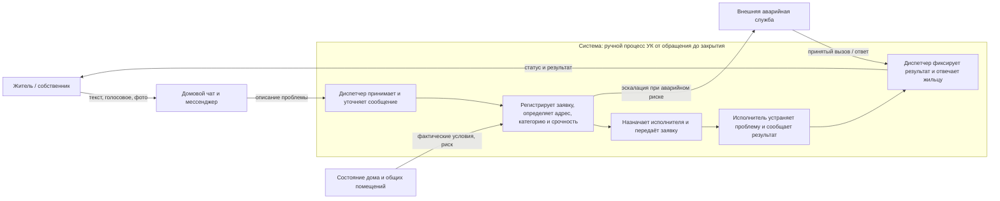

# Лабораторная 1. Границы и цель системы

**Тема:** обработка обращений жильцов в управляющую компанию (УК), проект AI City Requests.

## Контекстная диаграмма

**Граница.** Внутри — работа диспетчера, применяемые правила и журналы, передача заявки, устранение проблемы назначенным исполнителем и закрытие обращения с ответом жильцу. Исполнитель включён функционально, даже если он работает у подрядчика: без его результата система не достигает цели. Снаружи — жители как инициаторы и получатели услуги, каналы связи, состояние дома и внешние аварийные службы. Спорный элемент — сами чаты: это не процесс УК, а используемая среда обмена сообщениями; ручное чтение и перенос сообщения внутрь заявки уже относятся к системе. ИИ-продукт не входит в границу: рассматривается существующий ручной процесс.

## Заинтересованные стороны

| Сторона | Цель / критерий успеха | Где цель может расходиться с другими |
|---|---|---|
| Житель | Быстрое устранение проблемы, понятный срок и статус | Ожидает немедленной реакции даже на бытовую проблему; ресурсы УК ограничены |
| Диспетчер УК | Не потерять обращения, корректно оформить их и распределить поток | Скорость обработки может конфликтовать с подробным уточнением каждого сообщения |
| Руководство УК | Контролировать расходы, сроки, качество и ответственность | Экономия может конфликтовать с быстрым выездом и запасом ресурсов |
| Ремонтная бригада / подрядчик | Получить выполнимое поручение с точным адресом и достаточными данными | Неполная заявка и срочные переназначения нарушают план работ |
| Аварийная служба | Получать только обоснованные срочные вызовы и быстро локализовать опасность | Слишком осторожная эскалация перегружает службу; недостаточная — повышает ущерб и риск для людей |

## Записка: цель системы и наблюдения

**Система.** Это совместная работа жильца, диспетчера УК и исполнителей: сообщение о проблеме принимают через домовой чат или мессенджер, вручную превращают в заявку, определяют адрес, вид работ и срочность, передают ответственному исполнителю, а после работ фиксируют результат и сообщают его жильцу. Система существует, чтобы довести проблему в доме до подходящего исполнителя и не допустить, чтобы опасное обращение затерялось среди бытовых.

**Цель и признаки достижения.** Каждое обоснованное обращение должно получить прослеживаемую заявку, правильного исполнителя и обратную связь; опасные ситуации должны быть распознаны и переданы без задержки, установленной правилами УК. Это видно по доле обращений, ставших заявками и закрытых с подтверждённым результатом, времени от сообщения до регистрации и назначения, доле возвратов из-за нехватки данных, а также по времени эскалации аварийных случаев. Пороговые значения сроков нужно брать из регламента УК, а не придумывать.

**Три предварительных наблюдения.** Ниже — реконструкция по описанию темы проекта, а не подтверждённые полевые заметки; перед сдачей их нужно сверить с реальным наблюдением или разговором с участником процесса.

1. Одно обращение может прийти текстом, голосовым сообщением или фотографией, а заявку всё равно оформляет диспетчер. **Удивляет:** исходные данные уже есть, но они не совпадают с полями, нужными исполнителю.
2. Срочность приходится определять по неполному описанию, хотя цена ошибки у аварии и бытовой неисправности разная. **Удивляет:** первичная классификация — не просто канцелярская операция, а решение, связанное с безопасностью.
3. Работа диспетчера заканчивается не в момент отправки заявки: жильцу обещают срок, а результат зависит от бригады и должен вернуться в процесс. **Удивляет:** качество системы определяется не тем, как быстро создана запись, а тем, устранена ли проблема и узнал ли об этом житель.