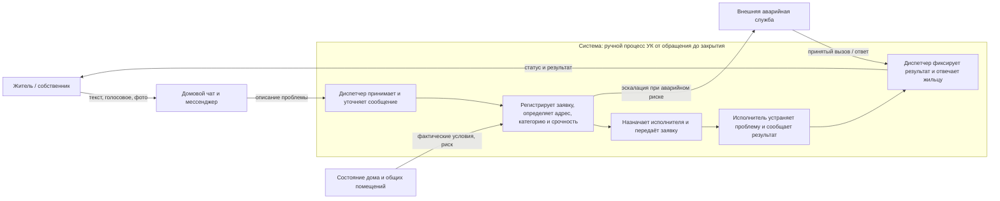

# Лабораторная 1. Границы и цель системы

**Тема:** обработка обращений жильцов в управляющую компанию (УК), проект AI City Requests.

## Контекстная диаграмма

**Граница.** Внутри системы находится весь цикл от получения сообщения до закрытия обращения: приём обращения, уточнение деталей, регистрация заявки, определение адреса, категории и срочности, передача исполнителю и ответ жильцу после устранения. Исполнитель включён функционально, даже если он работает у подрядчика: без его результатов система не достигает цели. Снаружи — жильцы, каналы связи, текущее состояние дома, внешние аварийные службы и сам ИИ-продукт как возможное будущее улучшение, но не часть текущей системы. Спорный элемент — домовой чат: это не сама система, а среда, в которой возникает обращение. Его читают и переводят в заявку внутри системы, поэтому перенос сообщения в заявку относится к системе, а не к среде.

## Заинтересованные стороны

| Сторона | Цель / критерий успеха | Где цель может расходиться с другими |
|---|---|---|
| Житель | Быстрое устранение проблемы, понятный срок и статус | Ожидает немедленной реакции даже на бытовую проблему; ресурсы УК ограничены |
| Диспетчер УК | Не потерять обращения, корректно оформить их и распределить поток | Скорость обработки может конфликтовать с подробным уточнением каждого сообщения |
| Руководство УК | Контролировать расходы, сроки, качество и ответственность | Экономия может конфликтовать с быстрым выездом и запасом ресурсов |
| Ремонтная бригада / подрядчик | Получить выполнимое поручение с точным адресом и достаточными данными | Неполная заявка и срочные переназначения нарушают план работ |
| Аварийная служба | Получать только обоснованные срочные вызовы и быстро локализовать опасность | Слишком осторожная эскалация перегружает службу; недостаточная — повышает ущерб и риск для людей |

## Записка: цель системы и наблюдения

**Система.** Система — это текущий ручной процесс решения проблем в доме, который запускается обращением жильца и заканчивается закрытием заявки после устранения неисправности. Жильцы сообщают проблему через домовой чат или мессенджер, диспетчер УК переводит это в заявку, определяет адрес, тип и срочность, назначает исполнителя, а после работ фиксирует результат и сообщает жильцу статус. Система существует, чтобы превращать разрозненные жалобы в управляемый поток работ и не пропускать аварийные случаи в общий поток бытовых обращений.

**Цель системы и признаки достижения.** Цель системы — обеспечить, чтобы каждое обращение было переведено в корректную заявку, направлено к правильному исполнителю и закрыто с подтверждённым результатом, а аварийные инциденты были выделены и обработаны быстрее бытовых. Это видно по тому, насколько быстро обращение превращается в заявку, сколько ошибок и возвратов возникает из-за недостатка данных, насколько точно определяется срочность и насколько быстро житель получает ответ о статусе и результате.

**Три наблюдения из похода в систему.** Ниже — конкретные наблюдения, которые можно описать как эпизоды из реальной практики работы УК: что именно увидели, кто участвовал, что поразило в процессе и почему это важно для системы.

1. В чате с жильцами одно и то же обращение часто приходило в виде текста, короткого аудиосообщения и фото с места проблемы. **Что удивило:** даже при наличии нескольких форматов данных диспетчер всё равно вручную превращал их в одну заявку, потому что в чате нет стандартной структуры для адреса, вида повреждения и категории работ. Ожидалось, что фото или голос сообщат всё автоматически, но на деле это только материалы, а не готовая заявка.
2. На одном из обращений диспетчер долго сверял, это авария или обычная бытовая неисправность: в сообщении было неясно, где именно течь, есть ли риск затопления соседей и когда проблема может стать опасной. **Что удивило:** срочность определялась не по формальным полям, а по человеческой оценке ситуации, и цена ошибки была большая: если принять проблему слишком «обычно», можно запоздать с аварийной реакцией; если переоценить, можно перегрузить бригаду и усложнить работу.
3. В конце процесса оказалось, что задача диспетчера не заканчивается на регистрации заявки: после передачи бригаде он ещё следил за тем, кто именно поехал, когда будет результат и как жильцу сообщат статус. **Что удивило:** настоящая система — это не «сделали заявку», а «проблема была закрыта и житель получил подтверждение», поэтому даже после передачи поручения работа диспетчера продолжается до обратной связи и закрытия обращения.