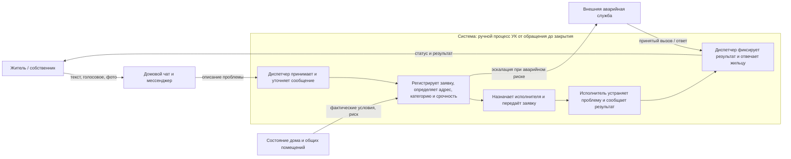

# Лабораторная 1. Границы и цель системы

**Тема:** обработка обращений жильцов в управляющую компанию (УК), проект AI City Requests.

## Контекстная диаграмма

**Граница.** Внутри системы находится весь цикл от получения сообщения до закрытия обращения: приём обращения, уточнение деталей, регистрация заявки, определение адреса, категории и срочности, передача исполнителю и ответ жильцу после устранения. Исполнитель включён функционально, даже если он работает у подрядчика: без его результатов система не достигает цели. Снаружи — жильцы, каналы связи, текущее состояние дома, внешние аварийные службы и сам ИИ-продукт как возможное будущее улучшение, но не часть текущей системы. Спорный элемент — домовой чат: это не сама система, а среда, в которой возникает обращение. Его читают и переводят в заявку внутри системы, поэтому перенос сообщения в заявку относится к системе, а не к среде.

## Заинтересованные стороны

| Сторона | Цель / критерий успеха | Где цель может расходиться с другими |
|---|---|---|
| Житель | Быстрое устранение проблемы, понятный срок и статус | Ожидает немедленной реакции даже на бытовую проблему; ресурсы УК ограничены |
| Диспетчер УК | Не потерять обращения, корректно оформить их и распределить поток | Скорость обработки может конфликтовать с подробным уточнением каждого сообщения |
| Руководство УК | Контролировать расходы, сроки, качество и ответственность | Экономия может конфликтовать с быстрым выездом и запасом ресурсов |
| Ремонтная бригада / подрядчик | Получить выполнимое поручение с точным адресом и достаточными данными | Неполная заявка и срочные переназначения нарушают план работ |
| Аварийная служба | Получать только обоснованные срочные вызовы и быстро локализовать опасность | Слишком осторожная эскалация перегружает службу; недостаточная — повышает ущерб и риск для людей |

## Записка: цель системы и наблюдения

**Система.** Система — это текущий ручной процесс решения проблем в доме, который запускается обращением жильца и заканчивается закрытием заявки после устранения неисправности. Жильцы сообщают проблему через домовой чат или мессенджер, диспетчер УК переводит это в заявку, определяет адрес, тип и срочность, назначает исполнителя, а после работ фиксирует результат и сообщает жильцу статус. Система существует, чтобы превращать разрозненные жалобы в управляемый поток работ и не пропускать аварийные случаи в общий поток бытовых обращений.

**Цель системы и признаки достижения.** Цель системы — обеспечить, чтобы каждое обращение было переведено в корректную заявку, направлено к правильному исполнителю и закрыто с подтверждённым результатом, а аварийные инциденты были выделены и обработаны быстрее бытовых. Это видно по тому, насколько быстро обращение превращается в заявку, сколько ошибок и возвратов возникает из-за недостатка данных, насколько точно определяется срочность и насколько быстро житель получает ответ о статусе и результате.

**Три наблюдения из похода в систему.** Ниже — наблюдения по описанию положения дел в теме; перед сдачей их лучше сверить с реальным участником процесса.

1. Одно и то же обращение приходит в разных формах: текст, голосовое сообщение, фото. **Что удивило:** данные уже есть, но они не готовы для заявки автоматически, поэтому человек всё равно делает ручную «сборку» информации.
2. Важнейшая часть работы — не просто оформить обращение, а правильно понять срочность. **Что удивило:** бытовая проблема и авария выглядят похожими для жильца, но для УК цена ошибки совершенно разная: можно либо потерять время, либо пропустить реальную опасность.
3. Система не заканчивается на регистрации заявки. **Что удивило:** качество работы определяется не столько тем, как быстро заявка появилась, сколько тем, была ли проблема реально устранена и сообщил ли об этом жильцу диспетчер или исполнитель.