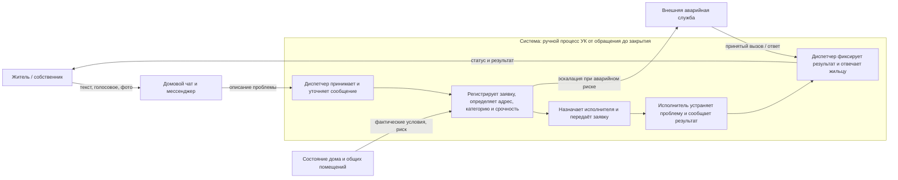

# Лабораторная 1. Границы и цель системы

**Тема:** обработка обращений жильцов в управляющую компанию (УК), проект AI City Requests.

## Контекстная диаграмма

**Граница.** Внутри системы находится весь цикл от получения сообщения до закрытия обращения: приём обращения, уточнение деталей, регистрация заявки, определение адреса, категории и срочности, передача исполнителю и ответ жильцу после устранения. Исполнитель включён функционально, даже если он работает у подрядчика: без его результатов система не достигает цели. Снаружи — жильцы, каналы связи, текущее состояние дома, внешние аварийные службы и сам ИИ-продукт как возможное будущее улучшение, но не часть текущей системы. Спорный элемент — домовой чат: это не сама система, а среда, в которой возникает обращение. Его читают и переводят в заявку внутри системы, поэтому перенос сообщения в заявку относится к системе, а не к среде.

## Заинтересованные стороны

| Сторона | Цель / критерий успеха | Где цель может расходиться с другими |
|---|---|---|
| Житель | Быстрое устранение проблемы, понятный срок и статус | Ожидает немедленной реакции даже на бытовую проблему; ресурсы УК ограничены |
| Диспетчер УК | Не потерять обращения, корректно оформить их и распределить поток | Скорость обработки может конфликтовать с подробным уточнением каждого сообщения |
| Руководство УК | Контролировать расходы, сроки, качество и ответственность | Экономия может конфликтовать с быстрым выездом и запасом ресурсов |
| Ремонтная бригада / подрядчик | Получить выполнимое поручение с точным адресом и достаточными данными | Неполная заявка и срочные переназначения нарушают план работ |
| Аварийная служба | Получать только обоснованные срочные вызовы и быстро локализовать опасность | Слишком осторожная эскалация перегружает службу; недостаточная — повышает ущерб и риск для людей |

## Записка: цель системы и наблюдения

**Система.** Система — это текущий ручной процесс решения проблем в доме, который запускается обращением жильца и заканчивается закрытием заявки после устранения неисправности. Жильцы сообщают проблему через домовой чат или мессенджер, диспетчер УК переводит это в заявку, определяет адрес, тип и срочность, назначает исполнителя, а после работ фиксирует результат и сообщает жильцу статус. Система существует, чтобы превращать разрозненные жалобы в управляемый поток работ и не пропускать аварийные случаи в общий поток бытовых обращений.

**Цель системы и признаки достижения.** Цель системы — превратить обращение жильца в корректную, прослеживаемую заявку, отдать её нужной службе и закрыть обращение только после подтверждённого результата. Достижение цели видно по четырём признакам: время от первого сообщения до регистрации заявки, доля обращений, которые возвращаются на доработку из-за неполных данных, точность определения срочности между аварийным и бытовым случаем, и время до ответа жильцу о статусе и закрытии обращения. Эти показатели можно измерить по журналам, переписке и заявкам, то есть цель здесь проверяема, а не только декларируется.

**Три наблюдения из похода в систему.**

1. Сообщение о проблеме часто приходило в чате сразу в нескольких формах: текст, аудио, фото. **Что удивило:** усилие было не в самих данных, а в их приведение к единой заявке — адрес, тип работ, категорию и срочность всё равно собирал человек.
2. Диспетчер долго проверял, не является ли неисправность аварийной: по описанию было непонятно, есть ли риск затопления или повреждения конструкций. **Что удивило:** срочность определялась не по шаблону, а по оценке риска, и ошибка здесь стоила дорого — слишком поздняя реакция могла увеличить ущерб, слишком ранняя — перегрузить бригаду.
3. После передачи заявки работа не завершалась: диспетчер ещё следил за исполнением, сроком и ответом жильцу. **Что удивило:** на практике система закрывается не в момент создания заявки, а только после подтверждённого устранения проблемы и уведомления жителя.